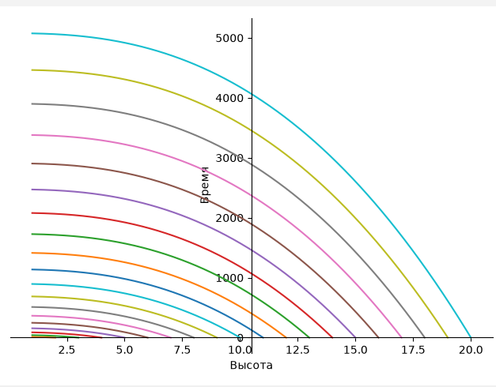
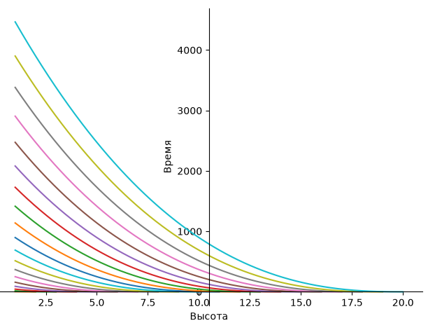
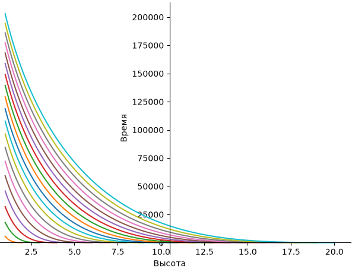
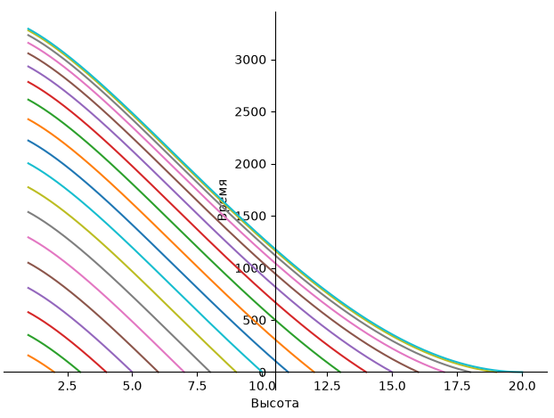
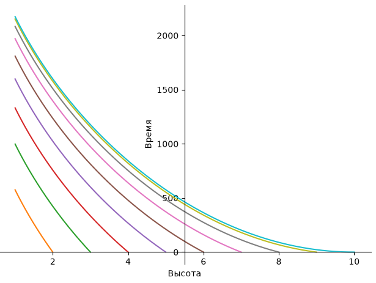
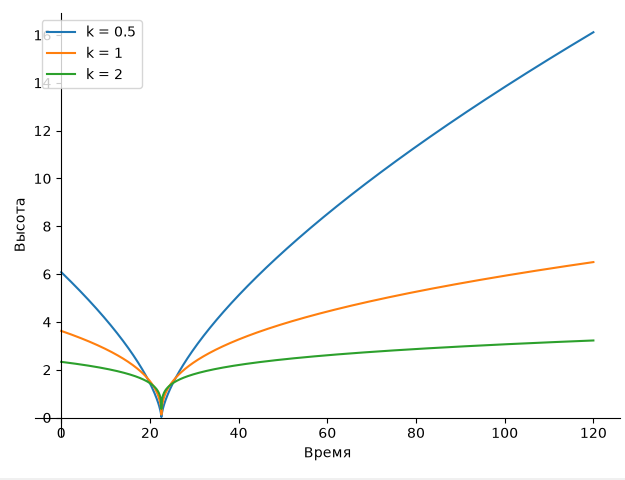
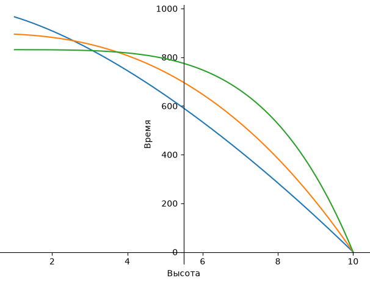
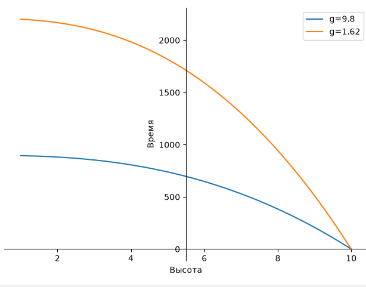

8. скорость постоянна при k = 0.25. Высота и время имеют линейную зависимость, что возможно если произваодная не меняется => скорость постоянна
9. 

10. 

11. 

12. 

13. 

14. 7.13324987043386e-8*15**(1/3)*2**(2/3)/pi**(2/3)
15. 
